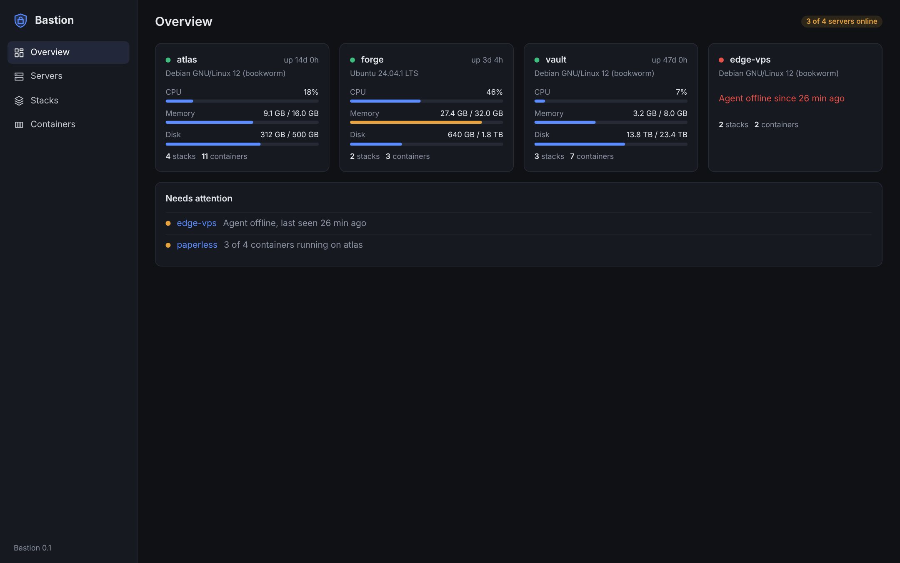

# Bastion

A panel for a homelab: the Docker compose stacks on all your servers, Nginx Proxy Manager, and game servers
run from Pterodactyl's eggs, in one place.

A small agent runs on each server and connects out to the panel, so servers need no open ports. The panel
shows each server's health, lists every stack and container, and lets you edit a stack's compose file and
`.env`, deploy it (or follow it from Git), update its images, read its logs live and open a console in its
containers. It manages Nginx Proxy Manager through NPM's own API, checks each proxy host is answering,
and runs game servers with a live console, file manager, schedules, backups, and sharing with friends.



## Status

Everything in the plan's three milestones is built ([docs/plan.md](docs/plan.md)): Docker stacks (0.1),
Nginx Proxy Manager (0.2) and game servers (0.3). It's been tested against real Docker, a real Nginx Proxy
Manager and a game egg in a real container; what couldn't be tested yet (real servers, passkeys on real
devices, Let's Encrypt, a real Minecraft download) is listed in the plan.

| Part | What it is |
|---|---|
| Panel web app (`web`) | Svelte. Overview, servers, alerts; Docker (stacks, containers, volumes, images); proxy (Nginx Proxy Manager); game servers and eggs; your account |
| Panel server (`cmd/bastion`, `internal/panel`) | One Go binary with the web app built in, SQLite, two-factor sign-in with passkeys, the agents' hub, NPM, eggs, schedules |
| Agent (`cmd/bastion-agent`, `internal/agent`) | One Go binary on each server: connects out, reports what Docker runs, and does only the operations in `docs/protocol.md` |

What's planned is in [docs/roadmap.md](docs/roadmap.md), and how it's being built, step by step, in
[docs/plan.md](docs/plan.md).

## Installing

[docs/install.md](docs/install.md): the panel in Docker behind your reverse proxy, then one command on each
server.

## Trying it

Requires Go and Node.js 22.

```sh
make
BASTION_PUBLIC_URL=http://localhost:8080 ./bin/bastion     # its log prints the setup link
```

Or just the screens, on a made-up homelab: `cd web && npm install && npm run demo`.

More in [docs/development.md](docs/development.md); how it's kept secure in [docs/security.md](docs/security.md).
What still needs testing on real servers is in [docs/testing.md](docs/testing.md).

## Layout

```
web/          the panel's web app (Svelte, Vite)
docs/               the plan, security, the API, development, the roadmap
```
